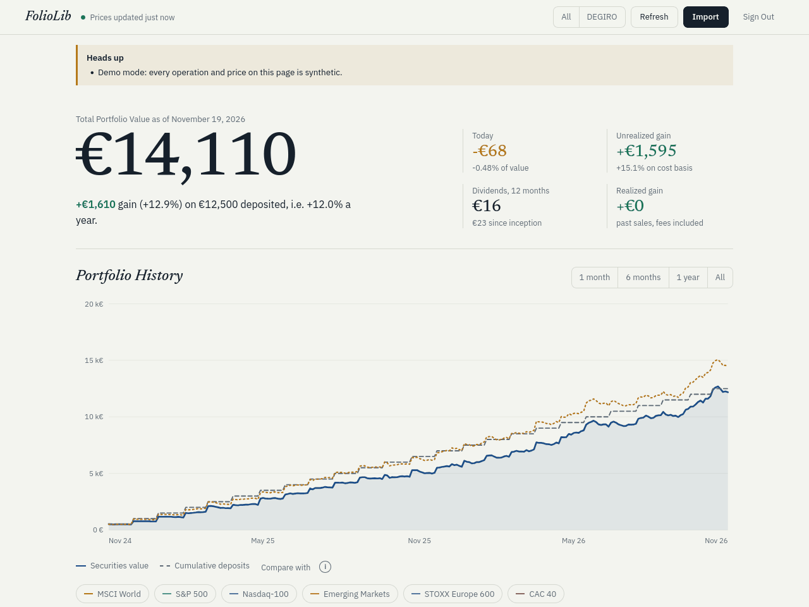
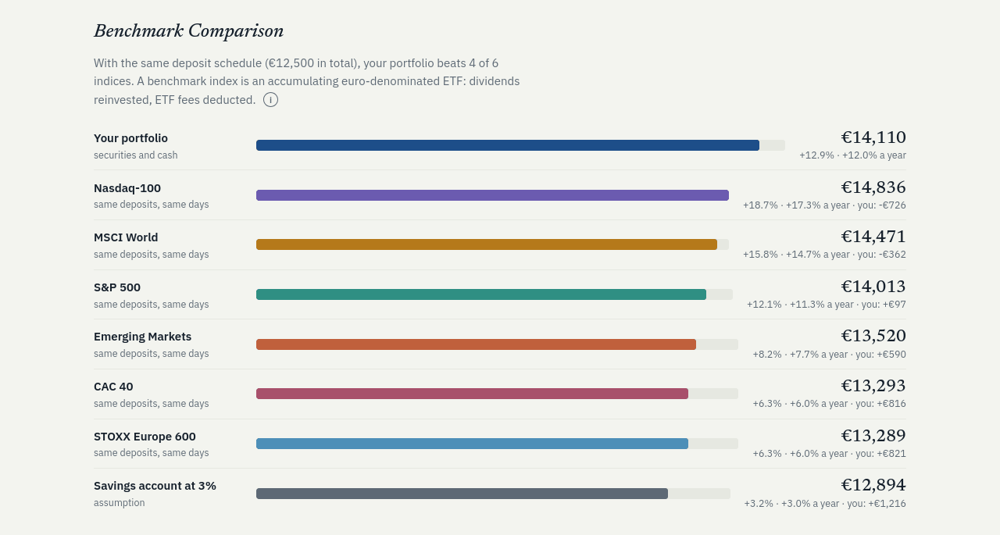
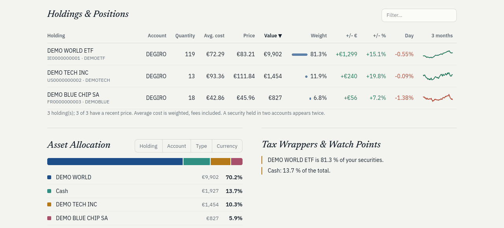
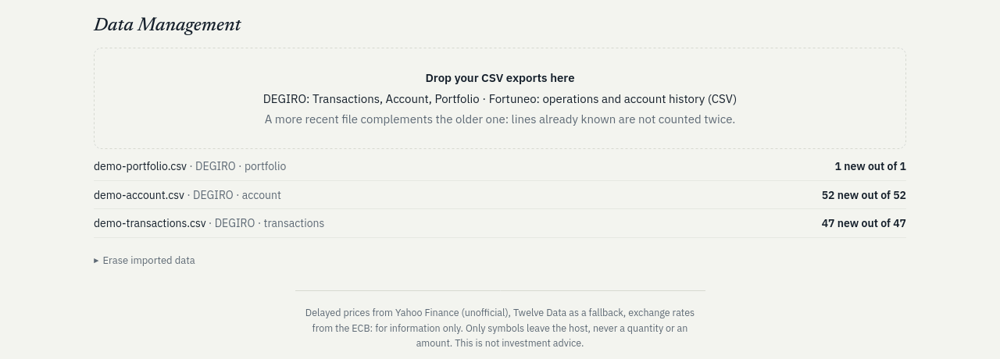

# FolioLib

**A small, private, self-hosted tracker for your investment portfolio.** Drop your broker's CSV exports on a page and get
positions, performance, risk, costs and a comparison with the main indices. Nothing is sent to a cloud, no bank
credentials are involved, and there is nothing to install besides Python or Docker.

[](https://github.com/louispro02/foliolib/actions/workflows/ci.yml)




> Every screenshot in this repository uses the built-in **synthetic demo data**. No real account is shown.

## Why FolioLib

- **Private by design.** Your data stays in a single SQLite file on your machine. There is no telemetry and no account on
  anyone's server. Only ticker symbols and ISINs are sent to a price service, never a quantity or an amount.
- **Nothing to install.** 100% Python standard library (SQLite in WAL mode, `http.server`), no framework, no Node.js, no
  database server. Serving the demo data on a Raspberry Pi 5 it used about **34 MB** of memory (45 MB at peak), and a full
  recalculation took about 0.1 s.
- **Drop, don't connect.** No bank aggregation, no OpenBanking, no password to hand over: you export a CSV from your broker
  and drop it on the page. Dropping an overlapping export twice never counts anything twice.
- **Honest numbers.** Time-weighted and money-weighted returns, risk measures with their uncertainty, fees and taxes
  itemized, and every figure explained in a tooltip.

## Quickstart

You need Docker with the Compose plugin.

```bash
git clone https://github.com/louispro02/foliolib.git
cd foliolib
docker compose up -d --build
docker compose exec foliolib python main.py passwd     # choose a username and a password (12 characters minimum)
```

Then open <http://localhost:8080> and sign in.

> **Read this before putting it on a network.** The session cookie is marked `Secure`, so browsers only keep it over
> `https://` or on `localhost`. If you open the page over plain `http://` from another machine, **the login will silently
> loop**. The compose file therefore publishes the port on `127.0.0.1` only. To use FolioLib from other devices, put a
> reverse proxy with TLS in front of it (Caddy, Traefik, Nginx...). A minimal Caddyfile is in `docker-compose.yml`.

### Try it with demo data first

On a fresh install, before importing anything:

```bash
docker compose exec foliolib python main.py demo
```

This loads two years of **fictitious** activity (monthly deposits, an ETF and two stocks, dividends, fees) with synthetic
prices, so you can explore every screen without any real data and without any network access. The page shows a "Demo mode"
banner. Use **Erase imported data** at the bottom of the page to remove it completely before importing your own exports.

### Without Docker

Python 3.11 or newer, nothing else:

```bash
cd app
FOLIOLIB_DATA=../data python3 main.py passwd
FOLIOLIB_DATA=../data python3 main.py serve --port 8080
```

## What you get

| | |
| --- | --- |
| **Positions** | Quantity, average cost (fees included), price, weight, unrealized and realized gains, dividends, a 3-month sparkline per line |
| **Performance** | Time-weighted return (TWR) and internal rate of return (IRR); periodic returns as a heatmap by month, quarter, half-year or year |
| **Risk** | Annualized volatility, Sharpe and Sortino ratios (Sharpe with its Lo (2002) standard error), maximum drawdown and recovery date, maximum run-up, 1-day 95% value at risk (parametric and historical) |
| **Benchmarks** | "Same deposits, same days" comparison with six accumulating ETFs (MSCI World, S&P 500, Nasdaq-100, Emerging Markets, STOXX Europe 600, CAC 40) and with a savings account |
| **Costs** | Brokerage, currency-conversion and connection fees, financial transaction tax, withholding tax on dividends, an estimate of the latent tax, and a "where the gain comes from" breakdown |
| **French wrappers** | PEA deposit ceiling (€150,000) and the date its five-year mark is reached |
| **Projection** | A long-term wealth simulator with editable assumptions; it runs in your browser |
| **Corporate actions** | Splits, reverse splits and automatic share exchanges keep their cost basis and cause no fake gain or loss |
| **Currencies** | Prices, dividends and fees in a foreign currency are converted to euros with ECB reference rates |
| **Robust imports** | Records are de-duplicated by a SHA-256 of their content; the raw files are kept, so a parser fix re-reads everything automatically with no re-upload |





## Supported exports

| Broker | Files | Language |
| --- | --- | --- |
| DEGIRO | Transactions, Account, Portfolio (CSV) | **French-language exports only** for now |
| Fortuneo | Operations history and cash account (CSV) | French |

Adding a broker takes one small file and no change anywhere else: see [CONTRIBUTING.md](CONTRIBUTING.md#add-support-for-your-broker).

## Privacy and security

**What leaves your machine.** Only these requests, and none of them carries an amount or a quantity:

| To | What is sent | Why |
| --- | --- | --- |
| Yahoo Finance (unofficial endpoint) | ISINs and ticker symbols | Prices and history |
| Twelve Data | Ticker symbols | Optional fallback, only if you put an API key in `twelvedata.key` in the data directory |
| Frankfurter (ECB reference rates) | A currency code and a date range | Exchange rates |

**How it is protected.**

- Password hashed with scrypt; the session cookie is HMAC-signed, `HttpOnly`, `Secure`, `SameSite=Strict`, valid 14 days.
- Cross-site requests are refused (`Sec-Fetch-Site` / `Origin` check), and a strict Content-Security-Policy allows only the
  application's own files. Fonts are self-hosted.
- The container runs as a non-root user with a read-only filesystem, no Linux capabilities and `no-new-privileges`.
- The database, the uploaded files and the password hash are created with mode `600`.

**What it does not do.**

- The data is **not encrypted at rest**. Use disk or volume encryption if the host is shared.
- It is a **single-user** application. After 5 failed sign-ins the login is locked for 10 minutes **for everyone**, so
  anyone who can reach the login page can lock you out for that long. Keep it off the public internet, or behind a VPN or an
  authenticating proxy.

Found a vulnerability? Please report it privately through the repository's **Security** tab rather than in a public issue.

## Configuration

| Setting | Default | Meaning |
| --- | --- | --- |
| `FOLIOLIB_DATA` | `/data` (in Docker) | Directory holding the database, uploads and login |
| `FOLIOLIB_PORT` | `8080` | Port to listen on (`serve --port N` overrides it) |
| `FOLIOLIB_HOST` | `0.0.0.0` | Address to listen on; use `127.0.0.1` to keep it local |
| `TZ` | `UTC` in the Docker image | Time zone used for "today" and for the logs (set it in your shell for Compose) |

Commands: `python main.py serve` (default), `passwd` (create or change the login), `report` (a text summary), `import FILE`
(import a CSV from the command line) and `demo`.

## How it compares

FolioLib is deliberately small. These tools solve overlapping problems differently; pick the one that fits you.

| | FolioLib | [Portfolio Performance](https://www.portfolio-performance.info/) | [Ghostfolio](https://ghostfol.io/) | [Finary](https://finary.com/) |
| --- | --- | --- | --- | --- |
| Form | Self-hosted web app | Desktop application | Self-hosted web app | Hosted service that aggregates accounts (DSP2) |
| Stack | Python standard library, SQLite | Java (Eclipse), local files | NestJS; PostgreSQL and Redis | n/a |
| License | AGPL-3.0 | Eclipse Public License 1.0 | AGPL-3.0 | Commercial service (free and paid plans) |

Checked on 2026-11-19 against each project's public pages. This is a snapshot, not a feature-by-feature review: read each
project's own documentation before deciding.

## Known limitations

- **French-language exports only.** DEGIRO and Fortuneo headers are matched in French. An export in another language is
  rejected with a clear message; supporting it means adding a parser class.
- **Euro-based.** Every amount is in euros; foreign-currency items are converted, but there is no base-currency setting.
- **French-oriented assumptions** are constants in `app/engine.py` and not configurable yet: PEA ceiling, the 30% flat tax
  used for the latent-tax estimate, the 3% savings-account reference.
- **Prices rely on an unofficial Yahoo Finance endpoint.** It can change or throttle without notice; FolioLib stops at the
  first refusal, keeps the last known prices and says so on the page.
- **Fonts.** The bundled IBM Plex Sans and Newsreader files are Latin subsets. The SIL Open Font License reserves the name
  "Plex" for unmodified distribution; if that matters for your use, replace them with the unmodified upstream releases
  (see [THIRD_PARTY_NOTICES.md](THIRD_PARTY_NOTICES.md)).
- Performance indicators start once the securities reach €500, and need at least 20 business days of history.

## Contributing

Bug reports, parsers for new brokers and fixes are welcome: see [CONTRIBUTING.md](CONTRIBUTING.md). The project has no
dependencies and wants to keep it that way.

## License

FolioLib is free software under the **GNU Affero General Public License v3.0**: see [LICENSE](LICENSE). If you run a
modified version as a network service, the AGPL requires you to offer its source code to its users. Bundled fonts are under
the SIL Open Font License: see [THIRD_PARTY_NOTICES.md](THIRD_PARTY_NOTICES.md).

## Disclaimer

FolioLib is provided for information only and is **not investment, tax or legal advice**. Its figures depend on your
exports, on third-party price data and on stated assumptions, and may be wrong: check anything that matters. It is not
affiliated with or endorsed by DEGIRO, flatexDEGIRO, Fortuneo, Yahoo, Twelve Data or the European Central Bank; all names and
trademarks belong to their owners.
